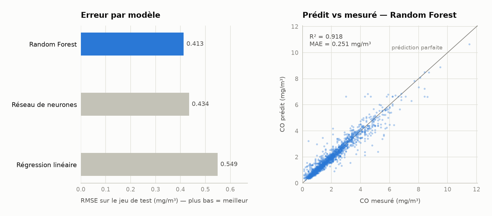
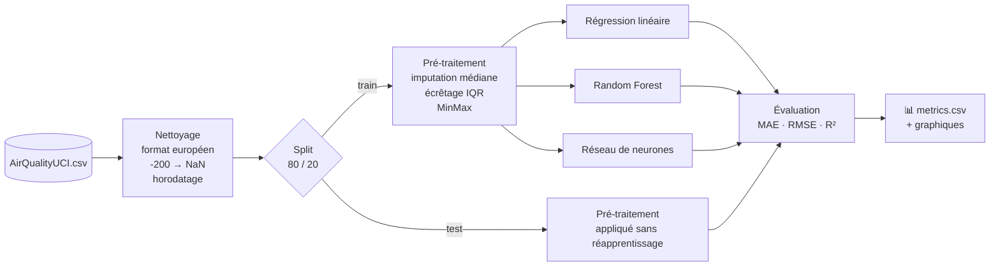

<div align="center">

# 🌫️ Air Quality — Prédire la pollution au CO par Machine Learning

**Estimer la concentration réelle de monoxyde de carbone à partir de capteurs chimiques bon marché,**
**en comparant régression linéaire, Random Forest et réseau de neurones.**


<br>

<picture>
  <source media="(prefers-color-scheme: dark)" srcset="outputs/results_dark.png">
  
</picture>

</div>

---

## 📌 Sommaire

- [Le problème](#-le-problème)
- [Résultats](#-résultats)
- [Le dataset](#️-le-dataset)
- [Le pipeline](#️-le-pipeline)
- [Démarrage rapide](#-démarrage-rapide)
- [Structure du projet](#-structure-du-projet)
- [Choix méthodologiques](#-choix-méthodologiques)
- [Pistes d'amélioration](#️-pistes-damélioration)
- [Source des données](#-source-des-données)

---

## 🎯 Le problème

Les analyseurs de référence qui mesurent la pollution de l'air sont **précis mais coûteux**. Ils sont aussi encombrants et demandent un entretien régulier. Les capteurs chimiques à oxyde métallique sont **bon marché**, mais leurs mesures dérivent et réagissent à plusieurs gaz à la fois.

**Question :** peut-on reconstituer la concentration réelle de CO (`CO(GT)`, mesurée par l'analyseur certifié) à partir des capteurs bon marché et de la météo ?

## 🏆 Résultats

Évaluation sur un jeu de test de **1 535 mesures horaires** jamais vues pendant l'entraînement :

| Modèle | MAE (mg/m³) ↓ | RMSE (mg/m³) ↓ | R² ↑ |
|:--|:--:|:--:|:--:|
| Régression linéaire | 0.337 | 0.549 | 0.855 |
| 🥇 **Random Forest** | **0.251** | **0.413** | **0.918** |
| Réseau de neurones (64-64-1) | 0.268 | 0.434 | 0.909 |

**Ce qu'il faut retenir :**

- 🌲 Le **Random Forest** explique **~92 % de la variance** du CO, avec une erreur moyenne de seulement **0,25 mg/m³**.
- 🧠 Le réseau de neurones fait presque aussi bien. Le Random Forest reste plus simple, plus rapide et plus interprétable.
- 📈 Les modèles non linéaires battent nettement la régression linéaire : la réponse des capteurs n'est pas linéaire.
- 🔬 Les variables les plus utiles sont le capteur **PT08.S2 (NMHC)** (61 % de l'importance) et la concentration de **benzène** (20 %). Ces deux polluants sont, comme le CO, émis par le trafic routier.

<details>
<summary><b>Importance des variables (Random Forest)</b></summary>

| Variable | Importance |
|:--|:--:|
| `PT08S2NMHC` — capteur NMHC | 0.611 |
| `C6H6GT` — benzène | 0.201 |
| `NOxGT` — oxydes d'azote | 0.074 |
| `NO2GT` — dioxyde d'azote | 0.026 |
| `PT08S1CO` — capteur CO | 0.023 |

</details>

## 🗂️ Le dataset

Le **[UCI Air Quality Dataset](https://archive.ics.uci.edu/dataset/360/air+quality)** regroupe **9 357 moyennes horaires** relevées de **mars 2004 à avril 2005**. Les mesures viennent d'un multicapteur placé au niveau de la route, dans une zone très polluée d'une ville italienne.

| Colonne | Description | Rôle |
|:--|:--|:--|
| `CO(GT)` | Concentration réelle de CO (mg/m³), analyseur de référence | 🎯 **Cible** |
| `PT08.S1(CO)` | Réponse du capteur à oxyde d'étain (cible : CO) | Variable |
| `C6H6(GT)` | Concentration réelle de benzène (µg/m³) | Variable |
| `PT08.S2(NMHC)` | Réponse du capteur à oxyde de titane (cible : NMHC) | Variable |
| `NOx(GT)` | Concentration réelle de NOx (ppb) | Variable |
| `PT08.S3(NOx)` | Réponse du capteur à oxyde de tungstène (cible : NOx) | Variable |
| `NO2(GT)` | Concentration réelle de NO₂ (µg/m³) | Variable |
| `PT08.S4(NO2)` | Réponse du capteur à oxyde de tungstène (cible : NO₂) | Variable |
| `PT08.S5(O3)` | Réponse du capteur à oxyde d'indium (cible : O₃) | Variable |
| `T`, `RH`, `AH` | Température (°C), humidité relative (%) et humidité absolue | Variables |
| `NMHC(GT)` | Hydrocarbures non méthaniques (µg/m³) | ❌ Exclue (90 % manquant) |

> ⚠️ **Piège du dataset :** les valeurs manquantes ne sont pas vides. Elles sont codées **`-200`**. Elles concernent 18 % des mesures de CO, et le pipeline les convertit explicitement en valeurs manquantes.

## ⚙️ Le pipeline



## 🚀 Démarrage rapide

```bash
# 1. Cloner le dépôt
git clone https://github.com/slimzrrk/air-quality.git
cd air-quality

# 2. Créer un environnement virtuel (Python 3.10 à 3.12 recommandé pour TensorFlow)
python3 -m venv .venv
source .venv/bin/activate        # Windows : .venv\Scripts\activate

# 3. Installer les dépendances
pip install -r requirements.txt

# 4. Lancer le pipeline complet (~10 secondes)
python model.py
```

**Options disponibles :**

| Commande | Effet |
|:--|:--|
| `python model.py --skip-nn` | Ignore le réseau de neurones (pas besoin de TensorFlow) |
| `python model.py --no-plot` | Ne génère pas les graphiques |
| `python model.py --epochs 100` | Nombre maximal d'époques du réseau (arrêt anticipé actif) |
| `python model.py --data chemin.csv` | Utilise un autre fichier de données |
| `python model.py --output-dir resultats/` | Change le dossier de sortie |

<details>
<summary><b>Exemple de sortie console</b></summary>

```text
1. Chargement et nettoyage des données
  9357 mesures horaires du 10/03/2004 au 04/04/2005
  Valeurs manquantes (%) : COGT 18.0, PT08S1CO 3.9, C6H6GT 3.9, ... NOxGT 17.5, NO2GT 17.5, ...
  7674 mesures avec CO renseigné, 11 variables explicatives

2. Entraînement des modèles
  Régression linéaire…
  Random Forest…
  Réseau de neurones…
  Entraînement arrêté après 98 époques.

3. Résultats sur le jeu de test (CO en mg/m³)
             Modèle   MAE  RMSE    R2
Régression linéaire 0.337 0.549 0.855
      Random Forest 0.251 0.413 0.918
 Réseau de neurones 0.268 0.434 0.909

  Meilleur modèle : Random Forest
```

</details>

## 📁 Structure du projet

```text
air-quality/
├── AirQualityUCI.csv            # Données brutes (UCI)
├── model.py                     # Pipeline complet : nettoyage → modèles → évaluation
├── requirements.txt             # Dépendances Python
└── outputs/                     # Généré par model.py
    ├── air_quality_cleaned.csv  # Données nettoyées
    ├── metrics.csv              # Scores des modèles
    ├── results_light.png        # Graphique des résultats (thème clair)
    └── results_dark.png         # Graphique des résultats (thème sombre)
```

## 🧪 Choix méthodologiques

| Étape | Choix | Pourquoi |
|:--|:--|:--|
| Valeurs `-200` | Converties en `NaN` | Ce sont des données manquantes, pas des mesures |
| Cible manquante | Lignes retirées de l'entraînement | Imputer la cible ferait apprendre au modèle des valeurs inventées |
| Imputation des variables | Médiane | Plus robuste que la moyenne aux pics de pollution |
| Valeurs aberrantes | Écrêtage aux bornes `Q1 − 1,5·IQR` / `Q3 + 1,5·IQR` | Limite l'influence des extrêmes sans supprimer de lignes |
| Normalisation | MinMax dans [0, 1] | Indispensable pour le réseau de neurones |
| Fuite de données | Pré-traitement appris **uniquement sur le train** | Le jeu de test reste réellement « jamais vu » |
| Réseau de neurones | Arrêt anticipé (patience 10) | Évite le sur-apprentissage et garde les meilleurs poids |
| Reproductibilité | Graine fixée (`42`) | Résultats identiques d'une exécution à l'autre |

## 🛣️ Pistes d'amélioration

- [ ] **Validation temporelle** : entraîner sur les premiers mois et tester sur les suivants (`TimeSeriesSplit`). Ce serait plus réaliste qu'un split aléatoire sur une série horaire.
- [ ] **Variables calendaires** : heure, jour de la semaine, mois. Le CO suit de près les heures de pointe du trafic.
- [ ] **Variables retardées** (lags) : valeurs des capteurs aux heures précédentes.
- [ ] **Gradient boosting** (XGBoost, LightGBM) et optimisation des hyperparamètres.
- [ ] **Validation croisée** pour des scores plus robustes.
- [ ] **Application interactive** (Streamlit) pour prédire le CO à partir de nouvelles mesures.

## 📚 Source des données

Dataset : **Air Quality**, UCI Machine Learning Repository, sous licence [CC BY 4.0](https://creativecommons.org/licenses/by/4.0/).

> S. De Vito, E. Massera, M. Piga, L. Martinotto, G. Di Francia. *On field calibration of an electronic nose for benzene estimation in an urban pollution monitoring scenario.* Sensors and Actuators B: Chemical, 129(2), 750–757, 2008.

---

<div align="center">

Réalisé par **[@slimzrrk](https://github.com/slimzrrk)** · ⭐ Si ce projet vous est utile, n'hésitez pas à lui donner une étoile !

</div>
